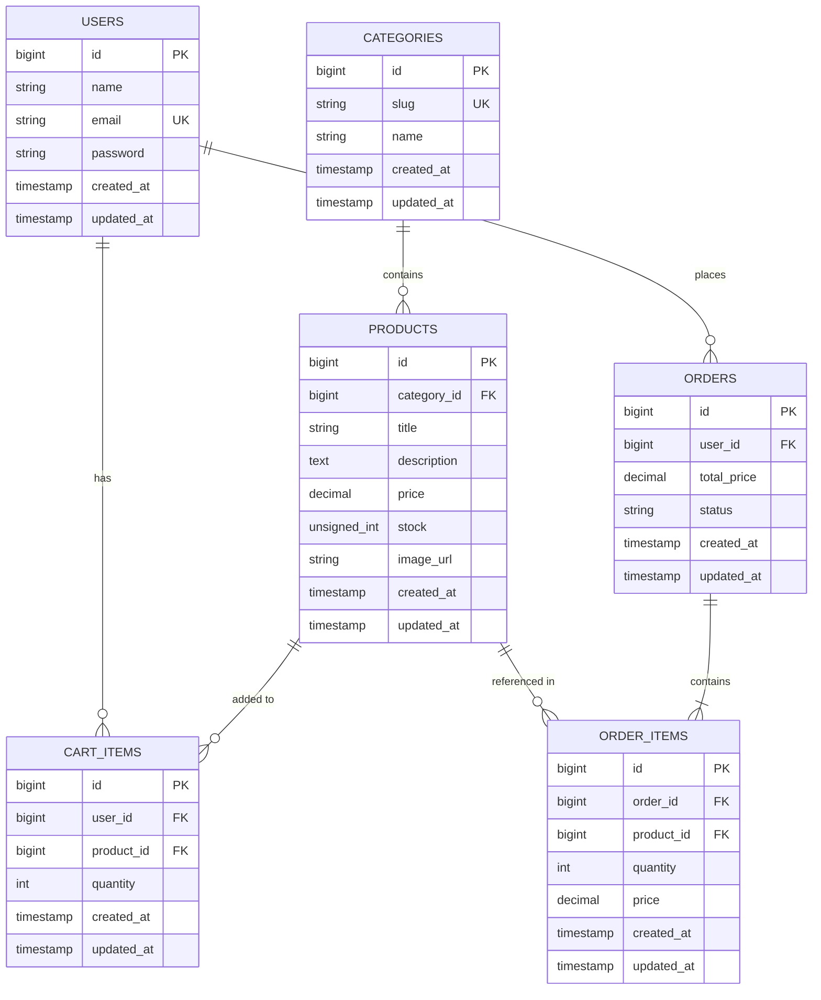

# Product Catalog & Order REST API - Talenavi Backend Technical Test

A robust, enterprise-grade RESTful API for an online store product catalog, shopping cart, and order checkout management built with **Laravel 12**, **PHP 8.2+**, **MySQL**, and **Laravel Sanctum**.

Developed for the **Technical Test Backend Developer Internship at PT Dynamic Talenta Navigator (Talenavi)**.

---

## 1. Project Overview

This application is a backend RESTful API built to provide complete e-commerce functionality for a modern online store. It handles the complete lifecycle from customer authentication, public product discovery, cart manipulation, through to transactional checkout and historical order retrieval.

### Purpose and Core Capabilities:
- **Stateless Authentication**: Secure customer registration and login with Bearer Token authorization powered by Laravel Sanctum.
- **Product Discovery & Exploration**: Publicly browsable product catalog equipped with full-text search, category filtering, whitelisted sorting options, and customizable pagination.
- **Dynamic Shopping Cart**: Real-time cart management with automatic line-item merging, inventory ceiling checks, subtotal calculations, and cart total aggregation.
- **Concurrency-Safe Checkout Engine**: High-integrity checkout execution using pessimistic row locking (`lockForUpdate`) inside atomic database transactions (`DB::transaction`) to guarantee data consistency and completely prevent overselling or race conditions.
- **Immutable Order Archiving**: Preserves historical price snapshots at the exact moment of order placement to maintain financial accuracy regardless of subsequent catalog updates.

---

## 2. Tech Stack

- **Backend Framework**: [Laravel 12](https://laravel.com/)
- **Programming Language**: PHP `^8.2` (Fully tested on PHP 8.2, PHP 8.3, and PHP 8.5)
- **Database**: MySQL `8.0+` / MariaDB `10.4+` (InnoDB Engine with ACID transaction support)
- **Authentication**: [Laravel Sanctum](https://laravel.com/docs/sanctum) (Bearer Token with configurable expiration)
- **API Style**: RESTful API with standardized JSON envelope responses
- **API Client & Testing**: [Postman](https://www.postman.com/) (Collection v2.1 & Environment included)

---

## 3. Database Selection

**MySQL** (with the **InnoDB** storage engine) was chosen as the primary relational database for this system.

### Technical Rationale & Alignment with Laravel:
1. **ACID Transaction Support for Checkout**:
   The checkout workflow involves multiple dependent database operations: verifying stock, inserting orders, generating order items, decrementing product inventory, and emptying the user's cart. MySQL InnoDB provides atomic transactions (`COMMIT` and `ROLLBACK`), guaranteeing that if any operation fails (such as an inventory deficit), the entire transaction reverts seamlessly without leaving orphaned or partial records.
2. **Pessimistic Row-Level Locking (`FOR UPDATE`)**:
   In high-concurrency e-commerce scenarios, multiple customers may attempt to purchase the final unit of a product simultaneously. MySQL InnoDB allows row-level locking via `lockForUpdate()`. By locking only the specific product rows being purchased, MySQL prevents dirty reads and negative stock levels while preserving high throughput for unrelated catalog browsing.
3. **Seamless Eloquent ORM Compatibility**:
   Laravel provides first-class support for MySQL. Migrations, strict foreign keys (`cascadeOnDelete`, `restrictOnDelete`), eager loading (`with()`), and prepared statements work natively with MySQL, eliminating impedance mismatch and maximizing query execution efficiency.

---

## 4. Features

### A. Authentication
- New user account registration with automatic password hashing (`bcrypt`).
- Secure login endpoint verifying email and password credentials.
- Sanctum Bearer Token generation with configurable expiration (`SANCTUM_EXPIRATION`).
- Authenticated user profile retrieval (`/api/auth/me`).

### B. Product Catalog (Public)
- Publicly accessible listing of available products.
- Keyword search by product title (`?q=phone`).
- Category filtering by category slug (`?category=electronics`).
- Whitelisted sort options: `price_asc`, `price_desc`, and `newest` (`?sort=price_asc`).
- Customizable pagination with metadata (`page`, `limit` up to 50, `total`, `total_pages`).
- Single product detail retrieval with eager-loaded category relation (`/api/products/{id}`).

### C. Categories (Public)
- Retrieval of all available product categories (`/api/categories`).

### D. Shopping Cart (Protected)
- Customer-scoped cart isolation: each user can strictly access and modify their own cart.
- Add product to cart: if the product already exists in the cart, the quantity is automatically merged and incremented rather than creating redundant rows.
- Stock threshold validation: prevents adding or updating cart quantities beyond available inventory.
- Real-time subtotal per item and overall grand total price calculation.
- Modify item quantity and remove item endpoints.

### E. Checkout (Protected)
- Checkouts the user's active shopping cart into a confirmed order.
- Wrapped in an atomic database transaction (`DB::transaction`).
- Utilizes deterministic ascending product ID locking (`lockForUpdate`) to eliminate transaction deadlocks.
- Validates stock across all items in the cart before committing changes.
- Automatically captures the product price snapshot into the order items.
- Decrements product inventory and empties the shopping cart upon success.
- Returns HTTP 409 Conflict with detailed item shortage information if stock is insufficient.

### F. Order Management (Protected)
- View order history for the authenticated user.
- View detailed order breakdown, including order status, total price, line item quantities, and snapshot checkout prices.
- Strict authorization: accessing orders belonging to another user returns HTTP 404 to avoid information disclosure.

### G. Validation and Security
- Strongly typed input validation via dedicated Laravel `FormRequest` classes.
- Uniform JSON validation error responses (HTTP 422).
- SQL Injection protection via PDO parameter binding throughout Eloquent and Query Builder calls.
- Production error sanitization: no internal database queries or stack traces are leaked to clients.

---

## 5. Database Design

The database schema comprises six core relational tables configured with foreign key constraints, indexes, and on-delete integrity rules.

### Entity Relationship Diagram (ERD)



### Table Specifications

1. **`users`**:
   - `id`, `name`, `email` (UNIQUE), `password` (hashed), `created_at`, `updated_at`.
2. **`categories`**:
   - `id`, `slug` (UNIQUE), `name`, `created_at`, `updated_at`.
3. **`products`**:
   - `id`, `category_id` (FK to `categories`), `title` (INDEXED for fast search), `description`, `price` (`DECIMAL(12, 2)`), `stock` (`UNSIGNED INT`), `image_url` (nullable), `timestamps`.
   - Foreign key constraint uses `restrictOnDelete()` to prevent accidental orphaning of catalog products when categories are modified.
4. **`cart_items`**:
   - `id`, `user_id` (FK to `users`), `product_id` (FK to `products`), `quantity` (`INT`), `timestamps`.
   - **`UNIQUE(user_id, product_id)`** composite constraint guarantees a single row per product per user cart.
   - Cascades on user or product removal.
5. **`orders`**:
   - `id`, `user_id` (FK to `users`), `total_price` (`DECIMAL(12, 2)`), `status` (default `'pending'`), `timestamps`.
6. **`order_items`**:
   - `id`, `order_id` (FK to `orders`), `product_id` (FK to `products`), `quantity` (`INT`), `price` (`DECIMAL(12, 2)`), `timestamps`.
   - Foreign key to `products` uses **`restrictOnDelete()`** so historical order records can never be broken or orphaned if product catalog adjustments occur.

### Role of `orders` and `order_items` & Historical Price Snapshots
In e-commerce, catalog prices fluctuate over time due to seasonal discounts, inflation, or merchant updates.
- If order history calculated subtotals by joining `products.price` directly, any catalog price change would alter the recorded value of past transactions, violating accounting and legal audit standards.
- **Implementation**: The application copies the active product price directly into `order_items.price` at the exact second the checkout transaction executes. Even if the catalog price changes later, the invoice and order items retain their authentic purchase-time value.

---

## 6. Project Requirements

Ensure the host machine satisfies the following prerequisites:
- **PHP**: Version `^8.2` (Tested on PHP 8.2, 8.3, and 8.5).
  - Required Extensions: `pdo_mysql`, `openssl`, `mbstring`, `tokenizer`, `xml`, `ctype`, `json`, `bcmath`, `curl`.
- **Composer**: Version `2.x+`.
- **Database**: MySQL `8.0+` or MariaDB `10.4+` running on port `3306`.
- **Git**: Installed and accessible from your terminal.

---

## 7. Installation Guide

Follow these steps to set up the project locally:

### Step 1: Clone the Repository
```bash
git clone https://github.com/<your-username>/Talenavi.git
cd Talenavi
```

### Step 2: Install Composer Dependencies
```bash
composer install
```

### Step 3: Set Up Environment Configuration
Duplicate the environment template:
```bash
cp .env.example .env
```
*(On Windows PowerShell: `Copy-Item .env.example .env`)*

### Step 4: Generate Application Encryption Key
```bash
php artisan key:generate
```

### Step 5: Configure MySQL Database
Open `.env` and verify your database connection settings:
```dotenv
DB_CONNECTION=mysql
DB_HOST=127.0.0.1
DB_PORT=3306
DB_DATABASE=fico_store
DB_USERNAME=root
DB_PASSWORD=

SANCTUM_EXPIRATION=1440
```

### Step 6: Create the MySQL Database
Ensure your MySQL server is running (e.g. via Laragon, XAMPP, or native service), then execute:
```sql
CREATE DATABASE IF NOT EXISTS fico_store;
```

### Step 7: Run Migrations and Seeders
```bash
php artisan migrate
php artisan db:seed
```

### Step 8: Start the Local Development Server
```bash
php artisan serve
```
The API is now live at: **`http://127.0.0.1:8000`**

---

## 8. Database Setup

Database schema creation and initial data population are executed via Laravel Artisan commands:

```bash
# Execute all database migrations in correct dependency order
php artisan migrate

# Seed database with categories, products, and test accounts
php artisan db:seed
```

### Seeder Idempotency
All seeders (`UserSeeder`, `CategorySeeder`, `ProductSeeder`) utilize `updateOrCreate()` based on stable unique attributes (`email`, `slug`, `title`). You can run `php artisan db:seed` multiple times safely without generating duplicate rows or corrupting auto-increment sequences.

---

## 9. Authentication

Authentication uses **Laravel Sanctum** issuing stateless **Bearer Tokens**.

- Protected endpoints require the `Authorization` header:
  ```http
  Authorization: Bearer <your_access_token>
  Accept: application/json
  ```
- Token lifetime is configurable in `.env` via `SANCTUM_EXPIRATION` (default: `1440` minutes / 24 hours).
- Accessing protected endpoints without a token or with an invalid token returns HTTP 401 Unauthorized.

### Seeded Test Account
Use the following credentials to authenticate immediately after running `php artisan db:seed`:

| Parameter | Value |
|---|---|
| **Email** | `test@gmail.com` |
| **Password** | `123` |

*(Note: Passwords are encrypted using Laravel's native `Hash::make()` with Bcrypt).*

---

## 10. API Endpoints

Base URL: `http://127.0.0.1:8000/api`

### A. Authentication
| Method | Endpoint | Authorization | Description |
|---|---|---|---|
| `POST` | `/api/auth/register` | Public | Register a new customer account |
| `POST` | `/api/auth/login` | Public | Log in with credentials and receive Bearer Token |
| `GET` | `/api/auth/me` | **Bearer Token** | Retrieve profile of the currently authenticated user |

### B. Products Catalog
| Method | Endpoint | Authorization | Description |
|---|---|---|---|
| `GET` | `/api/products` | Public | Browse paginated products with search, filter, and sort |
| `GET` | `/api/products/{id}` | Public | Retrieve single product details with category |

**Query Parameters supported on `GET /api/products`**:
- `page`: Page index (default: `1`).
- `limit`: Records per page (default: `10`, maximum: `50`).
- `q`: Search keyword matching against product title (e.g. `?q=headphones`).
- `category`: Filter products by category slug (e.g. `?category=electronics`).
- `sort`: Whitelisted sort order (`price_asc`, `price_desc`, or `newest`).
- *Example Query*: `/api/products?q=wireless&category=electronics&sort=price_asc&page=1&limit=10`

### C. Categories
| Method | Endpoint | Authorization | Description |
|---|---|---|---|
| `GET` | `/api/categories` | Public | Retrieve list of all product categories |

### D. Shopping Cart
| Method | Endpoint | Authorization | Description |
|---|---|---|---|
| `GET` | `/api/cart` | **Bearer Token** | Retrieve all cart items with subtotals and grand total |
| `POST` | `/api/cart/items` | **Bearer Token** | Add product to cart (auto-increments if already present) |
| `PATCH` | `/api/cart/items/{id}`| **Bearer Token** | Update quantity of a cart item |
| `DELETE`| `/api/cart/items/{id}`| **Bearer Token** | Remove an item from the cart |

### E. Orders & Checkout
| Method | Endpoint | Authorization | Description |
|---|---|---|---|
| `POST` | `/api/orders` | **Bearer Token** | Checkout active cart into a confirmed order |
| `GET` | `/api/orders` | **Bearer Token** | Retrieve order history for the authenticated user |
| `GET` | `/api/orders/{id}` | **Bearer Token** | Retrieve detailed order breakdown with snapshot prices |

---

## 11. API Documentation (Postman)

Ready-to-use Postman collection and environment files are available in the `docs/` directory:
- **Postman Collection**: [`docs/Talenavi-Backend-API.postman_collection.json`](file:///d:/coding/Talenavi/docs/Talenavi-Backend-API.postman_collection.json)
- **Postman Environment**: [`docs/Talenavi-Local.postman_environment.json`](file:///d:/coding/Talenavi/docs/Talenavi-Local.postman_environment.json)

### How to Import and Use in Postman:
1. Open **Postman**.
2. Click the **Import** button in the top left header.
3. Select or drag-and-drop both files from the `docs/` folder:
   - `docs/Talenavi-Backend-API.postman_collection.json`
   - `docs/Talenavi-Local.postman_environment.json`
4. Set your active environment in the top right dropdown to **Store Local** (or **Talenavi Local**).
5. Environment Variables:
   - `base_url`: `http://127.0.0.1:8000` (pre-configured).
   - `token`: Automatically populated when executing the **Auth $\rightarrow$ Login** request.

---

## 12. Checkout Business Logic

All business logic for order processing resides within [`app/Services/OrderService.php`](file:///d:/coding/Talenavi/app/Services/OrderService.php).

### Step-by-Step Checkout Flow:

```
[1. POST /api/orders] ──> [2. DB::transaction Start]
                                │
                                ▼
                 [3. Fetch User Cart Items]
                                │
                                ├─ Cart Empty? ──> [Throw EmptyCartException (400)]
                                ▼
                 [4. Sort Product IDs Ascending]
                                │
                                ▼
            [5. Lock Products with lockForUpdate()]
                                │
                                ▼
           [6. Validate Stock >= Requested Quantity]
                                │
                                ├─ Insufficient? ──> [Throw InsufficientStockException (409)]
                                ▼
          [7. Calculate Total Price (Integer Cents)]
                                │
                                ▼
             [8. Create Order Record (Status: pending)]
                                │
                                ▼
        [9. Create Order Items (Snapshot Product Price)]
                                │
                                ▼
           [10. Decrement Locked Product Stocks]
                                │
                                ▼
                [11. Delete All User Cart Items]
                                │
                                ▼
              [12. Commit Transaction & Return 201]
```

1. **Transaction Initialization (`DB::transaction`)**:
   The entire checkout sequence is wrapped in an atomic transaction. If any failure occurs, the database state is completely rolled back.
2. **Cart Retrieval & Validation**:
   The user's cart is loaded. If the cart is empty, an `EmptyCartException` is raised (`400 Bad Request`).
3. **Deadlock Prevention via Ascending ID Ordering**:
   Product IDs in the cart are sorted numerically ascending (`orderBy('id', 'asc')`). By locking rows in a consistent order across all concurrent requests, circular transaction wait conditions (deadlocks) are eliminated.
4. **Pessimistic Row Locking (`lockForUpdate`)**:
   Target product records are fetched with `SELECT ... FOR UPDATE`. Concurrent requests attempting to touch the same products are queued until this transaction finishes.
5. **Stock Verification**:
   The system validates whether every locked product has sufficient stock. If any product is short, an `InsufficientStockException` is thrown, aborting the transaction and returning `HTTP 409 Conflict` with itemized shortage details:
   ```json
   {
     "success": false,
     "message": "Checkout gagal karena terdapat produk dengan stok tidak mencukupi.",
     "errors": [
       {
         "product_id": 1,
         "title": "Wireless Noise-Canceling Headphones",
         "available_stock": 2,
         "requested_quantity": 5
       }
     ]
   }
   ```
6. **Integer-Cents Financial Precision**:
   Item subtotals and order totals are calculated using integer cents arithmetic (`(int) round($price * 100)`) to eliminate floating-point precision errors.
7. **Order & Order Items Creation**:
   - Creates the `orders` header record (`total_price`, `status = 'pending'`).
   - Creates `order_items` records storing line quantities and the captured purchase price snapshot (`order_items.price = products.price`).
8. **Inventory Reduction**:
   Stock for each product is decremented directly via `$product->decrement('stock', $quantity)`.
9. **Cart Clearing**:
   All cart records belonging to the authenticated user are removed.
10. **Transaction Commit**:
    The transaction commits and returns the completed order with eager-loaded items (`201 Created`).

---

## 13. Security

- **Password Hashing**: Passwords are never stored in plaintext. They are encrypted using `bcrypt` via Laravel's `Hash` facade (`Hash::make()`).
- **Sanctum Token Authentication**: Token verification operates via database lookup with SHA-256 token hashing.
- **User-Scoped Authorization**:
  - Cart and Order operations strictly scope queries to the authenticated user's ID (`$request->user()->id`).
  - Attempting to inspect, update, or delete items belonging to another user results in an `HTTP 404 Not Found` response, completely preventing identifier guessing or data probing attacks.
  - The client is never permitted to pass a `user_id` in request payloads.
- **SQL Injection Prevention**: All queries utilize Eloquent ORM and Laravel's Query Builder with parameterized bindings. Dynamic sorting uses strict whitelist mapping instead of passing user input into SQL clauses.
- **Input Validation**: Client inputs are sanitized and strictly validated using dedicated `FormRequest` classes.

---

## 14. Error Handling & Response Format

The API standardizes all responses using a predictable JSON structure across all endpoints.

### Success Response (`200 OK` / `201 Created`)
```json
{
  "success": true,
  "message": "Daftar produk berhasil diambil",
  "data": [ ... ],
  "meta": {
    "page": 1,
    "limit": 10,
    "total": 35,
    "total_pages": 4
  }
}
```

### Error Response (`400`, `401`, `403`, `404`, `409`, `422`, `500`)
```json
{
  "success": false,
  "message": "Validation failed",
  "errors": {
    "email": [
      "Email sudah terdaftar."
    ]
  }
}
```

### HTTP Status Codes Reference

| Status Code | Meaning | Usage in Application |
|---|---|---|
| **200 OK** | Success | Standard response for successful GET, PATCH, and DELETE operations. |
| **201 Created** | Created | Successful registration, cart item creation, or order placement. |
| **400 Bad Request** | Bad Request | Operation cannot proceed (e.g. attempting to checkout an empty cart). |
| **401 Unauthorized** | Unauthorized | Missing, expired, or invalid Bearer Token; incorrect login credentials. |
| **403 Forbidden** | Forbidden | Action forbidden for the current user. |
| **404 Not Found** | Not Found | Resource not found or belongs to another user. |
| **409 Conflict** | Conflict | Inventory shortage when adding to cart or checking out. |
| **422 Unprocessable Entity** | Validation Error | Request body failed form validation rules. |
| **500 Internal Server Error** | Server Error | Unhandled server exception (sanitized in production, no SQL or stack trace leaked). |

---

## 15. Repository Structure

```
Talenavi/
├── app/
│   ├── Exceptions/
│   │   ├── EmptyCartException.php
│   │   └── InsufficientStockException.php
│   ├── Http/
│   │   ├── Controllers/
│   │   │   ├── Api/
│   │   │   │   ├── AuthController.php
│   │   │   │   ├── CartController.php
│   │   │   │   ├── CategoryController.php
│   │   │   │   ├── OrderController.php
│   │   │   │   └── ProductController.php
│   │   │   └── Controller.php
│   │   └── Requests/
│   │       ├── AddToCartRequest.php
│   │       ├── LoginRequest.php
│   │       ├── ProductQueryRequest.php
│   │       ├── RegisterRequest.php
│   │       └── UpdateCartItemRequest.php
│   ├── Models/
│   │   ├── CartItem.php
│   │   ├── Category.php
│   │   ├── Order.php
│   │   ├── OrderItem.php
│   │   ├── Product.php
│   │   └── User.php
│   ├── Services/
│   │   ├── AuthService.php
│   │   ├── CartService.php
│   │   ├── OrderService.php
│   │   └── ProductService.php
│   └── Support/
│       └── ApiResponse.php
├── bootstrap/
│   └── app.php
├── config/
│   ├── database.php
│   ├── sanctum.php
│   └── ...
├── database/
│   ├── migrations/
│   │   ├── 0001_01_01_000000_create_users_table.php
│   │   ├── 2026_11_19_073100_create_personal_access_tokens_table.php
│   │   ├── 2026_11_19_073341_create_categories_table.php
│   │   ├── 2026_11_19_073342_create_products_table.php
│   │   ├── 2026_11_19_073343_create_cart_items_table.php
│   │   ├── 2026_11_19_073344_create_orders_table.php
│   │   └── 2026_11_19_073345_create_order_items_table.php
│   └── seeders/
│       ├── CategorySeeder.php
│       ├── DatabaseSeeder.php
│       ├── ProductSeeder.php
│       └── UserSeeder.php
├── docs/
│   ├── Talenavi-Backend-API.postman_collection.json
│   └── Talenavi-Local.postman_environment.json
├── routes/
│   └── api.php
├── .env.example
├── composer.json
└── README.md
```
