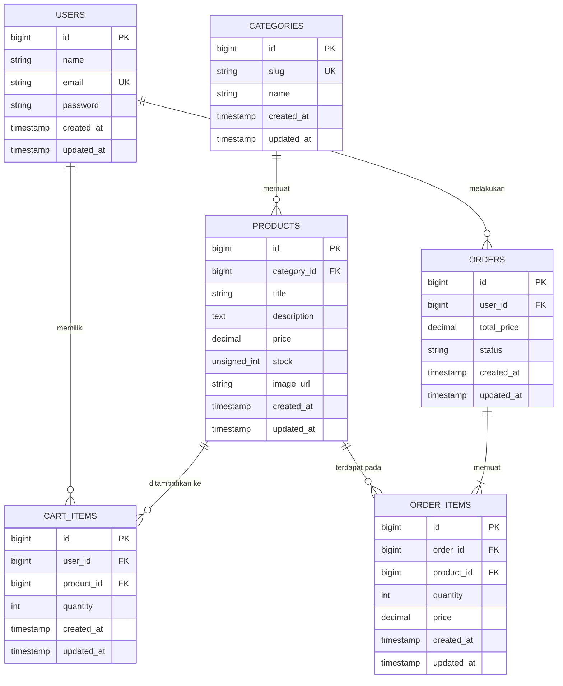

# Product Catalog & Order REST API - Talenavi Backend Technical Test

RESTful API untuk katalog produk, keranjang belanja (*shopping cart*), dan transaksi pesanan (*order checkout*) toko online yang dibangun menggunakan **Laravel 12**, **PHP 8.2+**, **MySQL**, dan **Laravel Sanctum**.

Proyek ini dikembangkan sebagai bagian dari **Technical Test Backend Developer Internship PT Dynamic Talenta Navigator (Talenavi)**.

---

## 1. Ringkasan Proyek (Project Overview)

Aplikasi ini merupakan backend RESTful API untuk mendukung operasional toko online sederhana hingga tingkat siap produksi (*production-ready*). Sistem ini menangani seluruh alur transaksi e-commerce, mulai dari autentikasi pengguna, eksplorasi katalog produk publik, pengelolaan keranjang belanja, hingga pemrosesan transaksi *checkout* dan riwayat pesanan.

### Tujuan dan Fitur Utama:
- **Autentikasi Pengguna**: Pendaftaran dan login akun dengan mekanisme *stateless* menggunakan Bearer Token dari Laravel Sanctum.
- **Katalog Produk Publik**: Akses katalog produk yang dapat dijelajahi tanpa login, dilengkapi pencarian kata kunci (*search*), filter slug kategori, pengurutan terverifikasi (*whitelisted sorting*), serta pagination dinamis.
- **Keranjang Belanja (*Shopping Cart*)**: Pengelolaan item keranjang yang terisolasi per pengguna, pencegahan baris ganda untuk produk yang sama, validasi batas stok secara langsung, dan kalkulasi otomatis subtotal serta total harga belanjaan.
- **Sistem Checkout Aman & Bebas Race Condition**: Checkout dengan jaminan transaksi database atomik (`DB::transaction`) dan penguncian baris pesimistik (*pessimistic row locking* menggunakan `lockForUpdate()`), memastikan tidak terjadi *overselling* maupun *deadlock* saat transaksi bersamaan.
- **Pencatatan Riwayat Pesanan & Snapshot Harga**: Menyimpan harga produk pada saat checkout secara permanen pada tabel `order_items`, sehingga riwayat transaksi dan faktur pelanggan tetap konsisten meskipun harga produk di katalog berubah sewaktu-waktu.

---

## 2. Tech Stack

- **Framework**: [Laravel 12](https://laravel.com/)
- **Bahasa Pemrograman**: PHP `^8.2` (Telah diuji dan sepenuhnya kompatibel dengan PHP 8.2, PHP 8.3, dan PHP 8.5)
- **Database**: MySQL `8.0+` / MariaDB `10.4+` (Engine InnoDB dengan dukungan transaksi ACID dan *row-level locking*)
- **Autentikasi**: [Laravel Sanctum](https://laravel.com/docs/sanctum) (Bearer Token dengan masa kedaluwarsa yang dapat dikonfigurasi)
- **Arsitektur API**: RESTful API terstruktur (Controller $\rightarrow$ Service $\rightarrow$ Model/Eloquent) dengan format response JSON seragam
- **Dokumentasi & Pengujian API**: [Postman](https://www.postman.com/) (Tersedia file Postman Collection v2.1 dan Environment)

---

## 3. Alasan Pemilihan Database (Database Selection)

**MySQL** (dengan storage engine **InnoDB**) dipilih sebagai database utama dalam pengembangan aplikasi ini.

### Alasan Teknis & Hubungannya dengan Laravel:
1. **Dukungan Penuh Transaksi ACID untuk Checkout**:
   Proses checkout e-commerce melibatkan rangkaian operasi yang saling bergantung: pengecekan ketersediaan stok, pembuatan data pesanan (*order*), pembuatan detail item (*order items*), pemotongan stok inventaris, serta pengosongan keranjang belanja. Mesin InnoDB pada MySQL menyediakan transaksi ACID (*Atomicity, Consistency, Isolation, Durability*) melalui perintah `COMMIT` dan `ROLLBACK`. Jika ada satu langkah yang gagal (misalnya stok produk tidak mencukupi), seluruh perubahan data dibatalkan secara utuh tanpa meninggalkan data yang rusak atau tidak lengkap.
2. **Pessimistic Row-Level Locking (`FOR UPDATE`)**:
   Pada kondisi tingginya transaksi bersamaan (*high concurrency*), dua pelanggan dapat mencoba membeli produk dengan stok terbatas pada detik yang sama. MySQL InnoDB mendukung penguncian tingkat baris (*row-level locking*) menggunakan klausa `SELECT ... FOR UPDATE` (di Laravel via `lockForUpdate()`). MySQL akan mengunci baris produk yang sedang diperiksa hingga transaksi selesai, mencegah terjadinya pembacaan data kotor (*dirty read*) dan memastikan stok tidak pernah minus tanpa perlu mengunci seluruh tabel.
3. **Kompatibilitas dan Integrasi Native dengan Laravel**:
   Laravel Query Builder dan Eloquent ORM memiliki optimasi bawaan terbaik untuk MySQL. Fitur deklarasi foreign key bersyarat (`cascadeOnDelete`, `restrictOnDelete`), eager loading (`with()`), index otomatis, serta PDO parameter binding berjalan secara native dan efisien.

---

## 4. Fitur Aplikasi (Features)

### A. Autentikasi (Authentication)
- Pendaftaran (*register*) pengguna baru dengan enkripsi password otomatis (`bcrypt`).
- Login pengguna menggunakan email dan password untuk mendapatkan Bearer Token.
- Pengaturan masa berlaku token melalui *environment variable* (`SANCTUM_EXPIRATION`).
- Mengambil informasi profil pengguna yang sedang login (`/api/auth/me`).

### B. Katalog Produk Publik (Product Catalog)
- Melihat seluruh daftar produk tanpa perlu login.
- Pencarian produk berdasarkan nama/judul produk (`?q=wireless`).
- Filter produk berdasarkan slug kategori (`?category=electronics`).
- Pilihan sorting yang aman (*whitelisted*): `price_asc` (harga terendah), `price_desc` (harga tertinggi), atau `newest` (terbaru).
- Pagination dinamis disertai metadata respons lengkap (`page`, `limit` hingga 50, `total`, `total_pages`).
- Melihat detail produk spesifik beserta data relasi kategorinya (`/api/products/{id}`).

### C. Kategori Produk (Categories)
- Melihat seluruh daftar kategori produk yang tersedia (`/api/categories`).

### D. Keranjang Belanja (Shopping Cart - Wajib Login)
- Setiap pengguna hanya dapat melihat dan mengelola isi keranjangnya sendiri (*user-scoped*).
- Menambah produk ke keranjang: jika produk sudah ada di keranjang, sistem otomatis menambahkan kuantitasnya (*increment*) tanpa membuat baris ganda di database.
- Validasi stok: kuantitas belanja tidak boleh melebihi sisa stok produk yang tersedia di database.
- Kalkulasi otomatis nilai subtotal per item dan total harga keseluruhan keranjang.
- Mengubah kuantitas item keranjang dengan pengecekan stok terkini.
- Menghapus item dari keranjang belanja.

### E. Checkout Pesanan (Checkout - Wajib Login)
- Mengubah seluruh isi keranjang belanja pengguna menjadi satu pesanan resmi.
- Berjalan di dalam satu transaksi database atomik (`DB::transaction`).
- Menerapkan pengurutan ID produk secara ascending sebelum dikunci untuk mencegah *database deadlock*.
- Memvalidasi stok setiap item sebelum proses penyimpanan data.
- Mengembalikan response `HTTP 409 Conflict` dengan detail produk yang stoknya kurang apabila terjadi defisit inventaris.
- Menyalin dan menyimpan harga produk saat checkout ke tabel `order_items` (*price snapshot*).
- Memotong stok setiap produk yang dibeli dan mengosongkan keranjang belanja secara otomatis.

### F. Manajemen Pesanan (Order Management - Wajib Login)
- Melihat daftar riwayat pesanan milik pengguna yang sedang login.
- Melihat rincian detail pesanan: total bayar, status pesanan, daftar barang yang dibeli, kuantitas, dan harga saat checkout.
- Proteksi otorisasi: pengguna tidak dapat melihat pesanan milik pengguna lain (sistem merespons dengan HTTP 404 Not Found).

### G. Validasi dan Keamanan
- Validasi data input yang ketat menggunakan class Laravel `FormRequest`.
- Format pesan error seragam ketika validasi gagal (HTTP 422 Unprocessable Entity).
- Perlindungan dari celah SQL Injection menggunakan PDO parameter binding pada seluruh query Eloquent.
- Penyembunyian error teknis pada mode produksi agar tidak membocorkan query database maupun stack trace internal ke client.

---

## 5. Desain Database & ERD (Database Design)

Struktur database dirancang dengan 6 tabel utama yang saling terhubung dengan foreign key, index pencarian, dan aturan penghapusan data yang tepat.

### Entity Relationship Diagram (ERD)



### Spesifikasi Tabel dan Relasi

1. **`users`**:
   - Kolom: `id`, `name`, `email` (UNIQUE), `password` (hashed), `created_at`, `updated_at`.
   - Menyimpan data akun pengguna dan pelanggan.
2. **`categories`**:
   - Kolom: `id`, `slug` (UNIQUE), `name`, `created_at`, `updated_at`.
   - Mengelompokkan kategori produk.
3. **`products`**:
   - Kolom: `id`, `category_id` (FK ke `categories`), `title` (INDEXED), `description`, `price` (`DECIMAL(12, 2)`), `stock` (`UNSIGNED INT`), `image_url` (nullable), `timestamps`.
   - Relasi ke kategori menggunakan aturan `restrictOnDelete()` agar kategori yang masih memiliki produk tidak dapat dihapus sembarangan.
4. **`cart_items`**:
   - Kolom: `id`, `user_id` (FK ke `users`), `product_id` (FK ke `products`), `quantity` (`INT`), `timestamps`.
   - Menggunakan aturan **`UNIQUE(user_id, product_id)`** agar setiap pengguna hanya memiliki satu baris keranjang untuk produk yang sama.
   - Aturan penghapusan `cascadeOnDelete()` jika user atau produk dihapus.
5. **`orders`**:
   - Kolom: `id`, `user_id` (FK ke `users`), `total_price` (`DECIMAL(12, 2)`), `status` (default `'pending'`), `timestamps`.
   - Menyimpan data transaksi pesanan yang telah berhasil dicheckout.
6. **`order_items`**:
   - Kolom: `id`, `order_id` (FK ke `orders`), `product_id` (FK ke `products`), `quantity` (`INT`), `price` (`DECIMAL(12, 2)`), `timestamps`.
   - Relasi foreign key ke `products` dilindungi dengan aturan **`restrictOnDelete()`** agar produk yang pernah dibeli tidak dapat dihapus permanen, sehingga integritas data audit dan riwayat pesanan tetap terjaga selamanya.

### Peran Tabel `orders`, `order_items`, dan Snapshot Harga Produk
Dalam sistem toko online, harga produk pada tabel `products` bersifat dinamis (dapat berubah karena promo, inflasi, atau perubahan harga dari pihak penjual).
- Apabila riwayat transaksi hanya mengambil harga dari kolom `products.price`, maka setiap ada perubahan harga di masa mendatang, total belanja pada pesanan lama pelanggan akan ikut berubah dan menyebabkan kekacauan pada laporan keuangan/faktur.
- **Solusi yang Diterapkan**: Pada saat checkout berhasil diproses, harga aktif produk saat itu disalin langsung ke kolom `order_items.price`. Dengan demikian, riwayat transaksi menjadi bersifat historis (*immutable*), akurat, dan tidak terpengaruh oleh perubahan harga katalog produk di kemudian hari.

---

## 6. Kebutuhan Sistem (Project Requirements)

Sebelum menjalankan aplikasi, pastikan perangkat lokal Anda memenuhi persyaratan berikut:
- **PHP**: Versi `^8.2` (Sistem telah diuji pada PHP 8.2, 8.3, dan 8.5).
  - Ekstensi PHP wajib: `pdo_mysql`, `openssl`, `mbstring`, `tokenizer`, `xml`, `ctype`, `json`, `bcmath`, `curl`.
- **Composer**: Versi `2.x+`.
- **Database Server**: MySQL `8.0+` atau MariaDB `10.4+` (berjalan pada port `3306`).
- **Git**: Terpasang di terminal komputer Anda.

---

## 7. Panduan Instalasi (Installation Guide)

Ikuti langkah-langkah berikut untuk menginstal dan menjalankan aplikasi di komputer lokal:

### Langkah 1: Clone Repository
```bash
git clone https://github.com/<username-anda>/Talenavi.git
cd Talenavi
```

### Langkah 2: Install Dependensi Composer
```bash
composer install
```

### Langkah 3: Siapkan File Environment
Salin template `.env.example` menjadi `.env`:
```bash
cp .env.example .env
```
*(Pada PowerShell Windows: `Copy-Item .env.example .env`)*

### Langkah 4: Generate Application Key
```bash
php artisan key:generate
```

### Langkah 5: Konfigurasi Database MySQL
Buka file `.env` menggunakan teks editor pilihan Anda dan sesuaikan kredensial database lokal Anda:
```dotenv
DB_CONNECTION=mysql
DB_HOST=127.0.0.1
DB_PORT=3306
DB_DATABASE=fico_store
DB_USERNAME=root
DB_PASSWORD=

SANCTUM_EXPIRATION=1440
```

### Langkah 6: Buat Database di MySQL
Pastikan service MySQL Anda sudah aktif (melalui Laragon / XAMPP / MySQL Service), kemudian buat database:
```sql
CREATE DATABASE IF NOT EXISTS fico_store;
```

### Langkah 7: Jalankan Migration dan Seeder
```bash
php artisan migrate
php artisan db:seed
```

### Langkah 8: Jalankan Server Lokal
```bash
php artisan serve
```
Aplikasi backend kini aktif dan siap menerima request di: **`http://127.0.0.1:8000`**

---

## 8. Konfigurasi & Setup Database (Database Setup)

Struktur tabel dan data awal diisi menggunakan perintah resmi Laravel Artisan:

```bash
# Menjalankan seluruh file migration sesuai urutan dependensi
php artisan migrate

# Mengisi data awal kategori, produk, dan akun testing
php artisan db:seed
```

### Prinsip Idempotency pada Seeder
Seluruh seeder (`UserSeeder`, `CategorySeeder`, `ProductSeeder`) menggunakan metode `updateOrCreate()` berdasarkan identifier unik yang stabil (`email`, `slug`, `title`). Anda dapat menjalankan perintah `php artisan db:seed` berkali-kali secara aman tanpa khawatir data menjadi duplikat atau merusak primary key yang sudah ada.

---

## 9. Autentikasi (Authentication)

Autentikasi API menggunakan **Laravel Sanctum** dengan metode **Bearer Token** (*stateless*).

- Setiap endpoint yang membutuhkan login wajib menyertakan header HTTP berikut:
  ```http
  Authorization: Bearer <token_anda_di_sini>
  Accept: application/json
  ```
- Masa berlaku token diatur melalui file konfigurasi `.env` dengan variabel `SANCTUM_EXPIRATION` (standar: `1440` menit atau 24 jam).
- Permintaan ke endpoint privat tanpa token atau dengan token yang tidak valid/kedaluwarsa akan menghasilkan response `HTTP 401 Unauthorized`.

### Akun Testing Hasil Seeder
Gunakan akun berikut untuk melakukan pengujian login secara langsung:

| Data | Nilai |
|---|---|
| **Email** | `test@gmail.com` |
| **Password** | `123` |

*(Catatan: Password di-hash secara aman menggunakan algoritma Bcrypt bawaan Laravel).*

---

## 10. Daftar Endpoint API (API Endpoints)

Base URL: `http://127.0.0.1:8000/api`

### A. Autentikasi (Authentication)
| Method | Endpoint | Akses | Keterangan |
|---|---|---|---|
| `POST` | `/api/auth/register` | Publik | Registrasi akun pengguna baru |
| `POST` | `/api/auth/login` | Publik | Login dengan email & password untuk mendapatkan Bearer Token |
| `GET` | `/api/auth/me` | **Bearer Token** | Mengambil data profil user yang sedang login |

### B. Katalog Produk Publik (Products)
| Method | Endpoint | Akses | Keterangan |
|---|---|---|---|
| `GET` | `/api/products` | Publik | Menampilkan daftar produk dengan pagination, search, filter, dan sorting |
| `GET` | `/api/products/{id}` | Publik | Menampilkan detail produk tertentu beserta relasi kategorinya |

**Parameter Query pada `GET /api/products`**:
- `page`: Nomor halaman (default: `1`).
- `limit`: Jumlah data per halaman (default: `10`, maksimal: `50`).
- `q`: Kata kunci pencarian judul produk (contoh: `?q=headphone`).
- `category`: Filter berdasarkan slug kategori (contoh: `?category=electronics`).
- `sort`: Pilihan pengurutan yang diizinkan: `price_asc`, `price_desc`, atau `newest`.
- *Contoh Kombinasi*: `/api/products?q=wireless&category=electronics&sort=price_asc&page=1&limit=10`

### C. Kategori (Categories)
| Method | Endpoint | Akses | Keterangan |
|---|---|---|---|
| `GET` | `/api/categories` | Publik | Menampilkan seluruh daftar kategori produk |

### D. Keranjang Belanja (Cart)
| Method | Endpoint | Akses | Keterangan |
|---|---|---|---|
| `GET` | `/api/cart` | **Bearer Token** | Menampilkan seluruh isi keranjang belanja user beserta total bayar |
| `POST` | `/api/cart/items` | **Bearer Token** | Menambahkan item ke keranjang (otomatis menambah kuantitas jika sudah ada) |
| `PATCH` | `/api/cart/items/{id}`| **Bearer Token** | Mengubah kuantitas item di keranjang belanja |
| `DELETE`| `/api/cart/items/{id}`| **Bearer Token** | Menghapus item dari keranjang belanja |

### E. Checkout & Pesanan (Orders)
| Method | Endpoint | Akses | Keterangan |
|---|---|---|---|
| `POST` | `/api/orders` | **Bearer Token** | Checkout seluruh isi keranjang menjadi pesanan |
| `GET` | `/api/orders` | **Bearer Token** | Menampilkan riwayat pesanan milik user yang sedang login |
| `GET` | `/api/orders/{id}` | **Bearer Token** | Menampilkan rincian detail pesanan dan harga snapshot saat checkout |

---

## 11. Dokumentasi API (Postman)

File Postman Collection dan Environment telah disediakan secara lengkap di dalam folder `docs/`:
- **Postman Collection**: [`docs/Talenavi-Backend-API.postman_collection.json`](file:///d:/coding/Talenavi/docs/Talenavi-Backend-API.postman_collection.json)
- **Postman Environment**: [`docs/Talenavi-Local.postman_environment.json`](file:///d:/coding/Talenavi/docs/Talenavi-Local.postman_environment.json)

### Cara Import dan Menggunakan di Postman:
1. Buka aplikasi **Postman**.
2. Klik tombol **Import** pada pojok kiri atas aplikasi.
3. Pilih atau geser (*drag & drop*) kedua file JSON di folder `docs/`:
   - `docs/Talenavi-Backend-API.postman_collection.json`
   - `docs/Talenavi-Local.postman_environment.json`
4. Pilih active environment di pojok kanan atas ke **Store Local** (atau **Talenavi Local**).
5. Variabel Environment yang tersedia:
   - `base_url`: `http://127.0.0.1:8000` (sudah terisi otomatis).
   - `token`: Nilai token terisi otomatis setelah Anda menjalankan request **Auth $\rightarrow$ Login**.

---

## 12. Alur Business Logic Checkout (Checkout Business Logic)

Seluruh logika bisnis checkout diisolasi secara mandiri pada layer Service di [`app/Services/OrderService.php`](file:///d:/coding/Talenavi/app/Services/OrderService.php) dengan urutan eksekusi sebagai berikut:

```
[1. Request POST /api/orders] ──> [2. Membuka DB::transaction]
                                         │
                                         ▼
                         [3. Mengambil Cart Item User]
                                         │
                                         ├─ Kosong? ──> [Throw EmptyCartException (400)]
                                         ▼
                         [4. Mengurutkan ID Produk (Ascending)]
                                         │
                                         ▼
                      [5. Mengunci Produk via lockForUpdate()]
                                         │
                                         ▼
                     [6. Memvalidasi Stok >= Kuantitas Belanja]
                                         │
                                         ├─ Stok Kurang? ──> [Throw InsufficientStockException (409)]
                                         ▼
                    [7. Menghitung Total Harga (Integer Cents)]
                                         │
                                         ▼
                     [8. Membuat Data Order (Status: pending)]
                                         │
                                         ▼
               [9. Membuat Order Items (Menyimpan Snapshot Harga)]
                                         │
                                         ▼
                   [10. Mengurangi Stok Produk yang Terkunci]
                                         │
                                         ▼
                    [11. Menghapus Seluruh Item di Keranjang]
                                         │
                                         ▼
                     [12. Commit Transaksi & Mengembalikan 201]
```

### Penjelasan Rinci Alur Checkout:
1. **Inisialisasi Database Transaction (`DB::transaction`)**:
   Semua tahapan checkout dijalankan dalam satu transaksi database. Apabila terjadi kegagalan di salah satu tahap, database akan melakukan *rollback* otomatis sehingga tidak ada data yang tersimpan separuh.
2. **Validasi Keranjang Belanja**:
   Sistem mengambil item keranjang user aktif. Jika keranjang kosong, checkout langsung digagalkan dengan melempar `EmptyCartException` (`HTTP 400 Bad Request`).
3. **Pencegahan Deadlock dengan Deterministic ID Ordering**:
   ID produk yang ada pada keranjang diurutkan secara ascending (`orderBy('id', 'asc')`). Hal ini menjamin bahwa seluruh proses checkout yang berjalan bersamaan selalu mengunci baris produk dengan urutan yang sama, sehingga *circular wait* (kondisi saling tunggu antar-transaksi yang memicu deadlock) dapat dihindari.
4. **Pessimistic Row Locking (`lockForUpdate`)**:
   Data produk dibaca menggunakan instruksi `SELECT ... FOR UPDATE`. Permintaan checkout lain yang mencoba menyentuh produk yang sama akan mengantre hingga transaksi aktif selesai.
5. **Validasi Ketersediaan Stok**:
   Sistem membandingkan kuantitas pesanan dengan sisa stok produk. Jika ada produk yang stoknya kurang, transaksi dibatalkan dan sistem melempar `InsufficientStockException` (`HTTP 409 Conflict`) yang menyertakan informasi lengkap mengenai produk yang kekurangan stok:
   ```json
   {
     "success": false,
     "message": "Checkout gagal karena terdapat produk dengan stok tidak mencukupi.",
     "errors": [
       {
         "product_id": 1,
         "title": "Wireless Noise-Canceling Headphones",
         "available_stock": 2,
         "requested_quantity": 5
       }
     ]
   }
   ```
6. **Perhitungan Finansial Presisi Tinggi (Integer Cents)**:
   Perhitungan subtotal dan total harga dikonversi ke satuan sen integer (`(int) round($price * 100)`) sebelum dijumlahkan, menghilangkan potensi bug pembulatan desimal akibat kalkulasi *floating-point*.
7. **Penyimpanan Order & Order Items**:
   - Membuat baris baru pada tabel `orders` (`total_price`, `status = 'pending'`).
   - Membuat baris data pada tabel `order_items` dengan mencatat kuantitas serta snapshot harga produk saat checkout (`order_items.price = products.price`).
8. **Pengurangan Stok Produk**:
   Stok masing-masing produk yang terkunci dikurangi sesuai kuantitas yang dibeli menggunakan perintah `$product->decrement('stock', $quantity)`.
9. **Pengosongan Keranjang**:
   Semua item dalam keranjang milik user yang bersangkutan dihapus dari database.
10. **Commit Transaksi**:
    Transaksi disimpan permanen (*committed*) dan sistem mengembalikan response pesanan lengkap dengan kode status `HTTP 201 Created`.

---

## 13. Keamanan (Security)

- **Enkripsi Password**: Password tidak pernah disimpan dalam bentuk teks biasa (*plain text*), melainkan di-hash menggunakan algoritma Bcrypt via facade `Hash::make()`.
- **Autentikasi Token Sanctum**: Token diverifikasi secara *stateless* dan dicocokkan dengan hash SHA-256 yang tersimpan pada tabel `personal_access_tokens`.
- **Otorisasi Data Berbasis Pengguna (*User-Scoped Authorization*)**:
  - Seluruh query keranjang dan pesanan difilter berdasarkan ID pengguna yang sedang login (`$request->user()->id`).
  - Mengakses atau memodifikasi item keranjang atau pesanan milik pengguna lain akan langsung menghasilkan respon `HTTP 404 Not Found` guna mencegah kebocoran informasi (*data enumeration*).
  - Client tidak pernah diizinkan mengirimkan kolom `user_id` secara manual pada body request.
- **Pencegahan SQL Injection**: Seluruh komunikasi dengan database memanfaatkan Eloquent ORM dan Laravel Query Builder dengan prepared statements dan parameter binding. Parameter sorting menggunakan pencocokan daftar putih (*whitelist matching*) sehingga input mentah dari client tidak pernah disambungkan langsung ke query SQL.
- **Validasi Input**: Seluruh input dari client divalidasi dan disanitasi secara ketat menggunakan class `FormRequest`.

---

## 14. Format Response & Penanganan Error (Error Handling)

Format JSON response telah distandarisasi di seluruh endpoint menggunakan helper [`app/Support/ApiResponse.php`](file:///d:/coding/Talenavi/app/Support/ApiResponse.php).

### Format Response Sukses (`200 OK` / `201 Created`)
```json
{
  "success": true,
  "message": "Daftar produk berhasil diambil",
  "data": [ ... ],
  "meta": {
    "page": 1,
    "limit": 10,
    "total": 35,
    "total_pages": 4
  }
}
```

### Format Response Error (`400`, `401`, `403`, `404`, `409`, `422`, `500`)
```json
{
  "success": false,
  "message": "Validation failed",
  "errors": {
    "email": [
      "Email sudah terdaftar."
    ]
  }
}
```

### Daftar HTTP Status Code yang Digunakan

| Kode Status | Kategori | Penggunaan pada Aplikasi |
|---|---|---|
| **200 OK** | Sukses | Response standar untuk operasi GET, PATCH, dan DELETE yang berhasil. |
| **201 Created** | Sukses Dibuat | Berhasil registrasi user, menambah item keranjang, atau menyelesaikan checkout order. |
| **400 Bad Request** | Permintaan Salah | Permintaan tidak dapat diproses (misalnya mencoba checkout keranjang yang kosong). |
| **401 Unauthorized** | Tidak Terautentikasi | Token tidak disertakan, kedaluwarsa, tidak valid, atau kredensial login salah. |
| **403 Forbidden** | Terlarang | Pengguna tidak memiliki hak akses terhadap tindakan terkait. |
| **404 Not Found** | Tidak Ditemukan | Data tidak ditemukan atau data milik user lain (disamarkan sebagai 404 demi keamanan). |
| **409 Conflict** | Konflik Bisnis | Permintaan kuantitas melebihi sisa stok produk yang tersedia di inventaris. |
| **422 Unprocessable Entity** | Validasi Gagal | Data yang dikirimkan pada body request tidak memenuhi aturan Form Request. |
| **500 Internal Server Error** | Kesalahan Server | Kesalahan internal server (pesan error disanitasi agar tidak membocorkan query database). |

---

## 15. Struktur Direktori Repository (Repository Structure)

Berikut adalah struktur folder dan file utama yang ada di dalam project:

```
Talenavi/
├── app/
│   ├── Exceptions/
│   │   ├── EmptyCartException.php
│   │   └── InsufficientStockException.php
│   ├── Http/
│   │   ├── Controllers/
│   │   │   ├── Api/
│   │   │   │   ├── AuthController.php
│   │   │   │   ├── CartController.php
│   │   │   │   ├── CategoryController.php
│   │   │   │   ├── OrderController.php
│   │   │   │   └── ProductController.php
│   │   │   └── Controller.php
│   │   └── Requests/
│   │       ├── AddToCartRequest.php
│   │       ├── LoginRequest.php
│   │       ├── ProductQueryRequest.php
│   │       ├── RegisterRequest.php
│   │       └── UpdateCartItemRequest.php
│   ├── Models/
│   │   ├── CartItem.php
│   │   ├── Category.php
│   │   ├── Order.php
│   │   ├── OrderItem.php
│   │   ├── Product.php
│   │   └── User.php
│   ├── Services/
│   │   ├── AuthService.php
│   │   ├── CartService.php
│   │   ├── OrderService.php
│   │   └── ProductService.php
│   └── Support/
│       └── ApiResponse.php
├── bootstrap/
│   └── app.php
├── config/
│   ├── database.php
│   ├── sanctum.php
│   └── ...
├── database/
│   ├── migrations/
│   │   ├── 0001_01_01_000000_create_users_table.php
│   │   ├── 2026_11_19_073100_create_personal_access_tokens_table.php
│   │   ├── 2026_11_19_073341_create_categories_table.php
│   │   ├── 2026_11_19_073342_create_products_table.php
│   │   ├── 2026_11_19_073343_create_cart_items_table.php
│   │   ├── 2026_11_19_073344_create_orders_table.php
│   │   └── 2026_11_19_073345_create_order_items_table.php
│   └── seeders/
│       ├── CategorySeeder.php
│       ├── DatabaseSeeder.php
│       ├── ProductSeeder.php
│       └── UserSeeder.php
├── docs/
│   ├── Talenavi-Backend-API.postman_collection.json
│   └── Talenavi-Local.postman_environment.json
├── routes/
│   └── api.php
├── .env.example
├── composer.json
└── README.md
```
