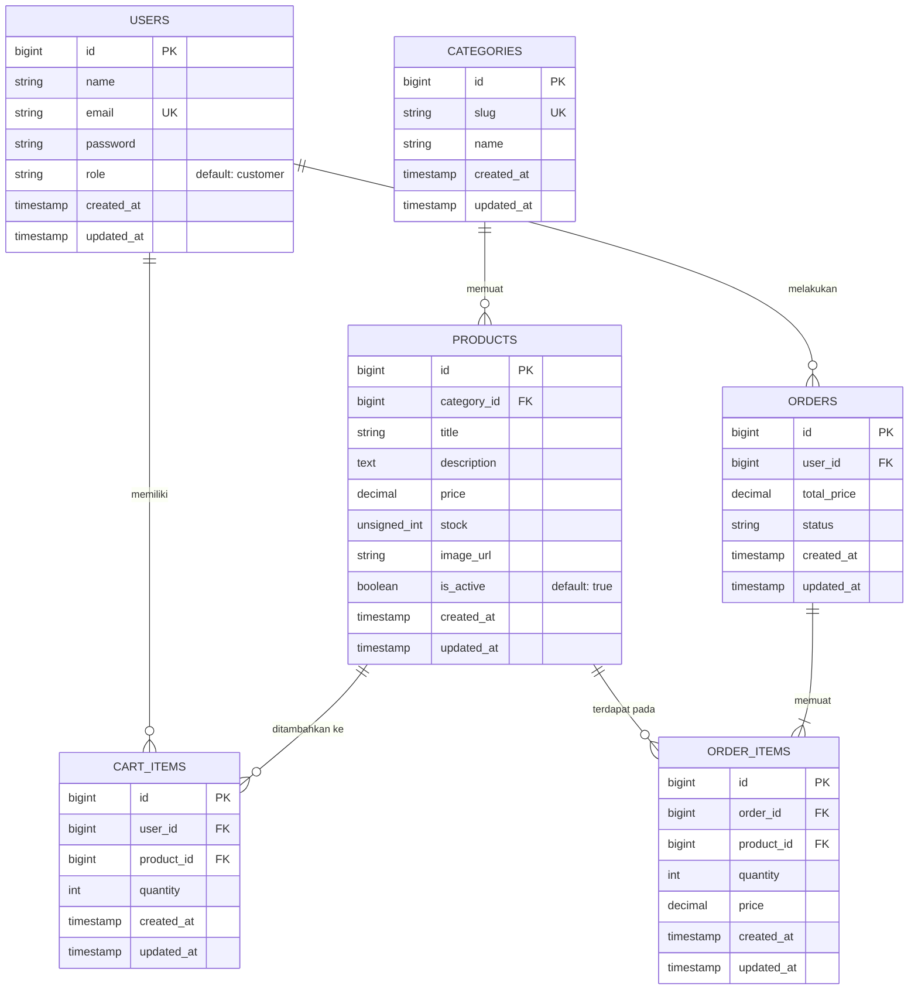

# Product Catalog & Order REST API - Talenavi Backend Technical Test

RESTful API untuk katalog produk, keranjang belanja (*shopping cart*), transaksi pesanan (*order checkout*), dan panel manajemen administrator toko online yang dibangun menggunakan **Laravel 12**, **PHP 8.2+**, **MySQL**, dan **Laravel Sanctum**.

Proyek ini dikembangkan secara komprehensif untuk **Technical Test Backend Developer Internship PT Dynamic Talenta Navigator (Talenavi)**, mencakup **seluruh fitur wajib** dan **seluruh fitur opsional (nilai tambah)**.

---

## 1. Ringkasan Proyek (Project Overview)

Aplikasi ini merupakan backend RESTful API lengkap untuk mendukung operasional toko online modern hingga level *production-ready*. Sistem ini menangani seluruh alur transaksi e-commerce secara terorganisasi, modular, dan aman:
- **Autentikasi Stateless & Multi-Role**: Registrasi, login, dan pembagian hak akses (*Role-Based Access Control*) antara `customer` dan `admin` menggunakan Bearer Token dari Laravel Sanctum.
- **Katalog Produk Publik**: Akses katalog produk yang dapat dijelajahi publik, dilengkapi fitur pencarian judul, filter slug kategori, pengurutan terverifikasi (*whitelisted sorting*), serta pagination dinamis. Hanya produk aktif yang ditampilkan di katalog publik.
- **Panel Administrator (Admin Product CRUD)**: Hak akses khusus admin untuk mengelola seluruh siklus produk (tambah, lihat, ubah, dan nonaktifkan produk).
- **Keranjang Belanja (*Shopping Cart*)**: Pengelolaan item keranjang yang terisolasi per pengguna, pencegahan baris ganda untuk produk yang sama, validasi batas stok secara langsung, dan kalkulasi otomatis subtotal serta total belanja.
- **Sistem Checkout Concurrency-Safe**: Checkout dengan jaminan transaksi database atomik (`DB::transaction`) dan penguncian baris pesimistik (*pessimistic row locking* menggunakan `lockForUpdate()`), memastikan tidak terjadi *overselling* maupun *deadlock* saat transaksi berlangsung bersamaan.
- **Pencatatan Riwayat Pesanan & Snapshot Harga**: Menyimpan harga produk pada saat checkout secara permanen pada tabel `order_items`, sehingga riwayat transaksi dan faktur pelanggan tetap konsisten meskipun harga atau status produk berubah di masa mendatang.
- **Keamanan, Logging & Ketahanan Produksi**: Rate limiting pada login, pencatatan log terstruktur disertai *Request ID* (`X-Request-ID`), *health check endpoint*, konfigurasi Docker multi-container, dan pengujian otomatis (*automated tests*).

---

## 2. Tech Stack

- **Backend Framework**: [Laravel 12](https://laravel.com/)
- **Bahasa Pemrograman**: PHP `^8.2` (Diuji dan kompatibel penuh pada PHP 8.2, PHP 8.3, dan PHP 8.5)
- **Database**: MySQL `8.0+` / MariaDB `10.4+` (Engine InnoDB dengan dukungan transaksi ACID dan *row-level locking*)
- **Autentikasi**: [Laravel Sanctum](https://laravel.com/docs/sanctum) (Bearer Token dengan masa berlaku dinamis)
- **Containerization**: Docker & Docker Compose (PHP-FPM, Nginx Alpine, MySQL 8.0, phpMyAdmin)
- **Testing Framework**: PHPUnit (38 automated tests mencakup Unit, Feature, Security, dan Concurrency)
- **Arsitektur API**: Service-Layered RESTful API (Controller $\rightarrow$ Service $\rightarrow$ Eloquent Model)
- **Dokumentasi & Pengujian API**: [Postman](https://www.postman.com/) (Collection v2.1 dan Environment)

---

## 3. Alasan Pemilihan Database (Database Selection)

**MySQL** (dengan storage engine **InnoDB**) dipilih sebagai database utama dalam pengembangan aplikasi ini.

### Alasan Teknis & Hubungannya dengan Laravel:
1. **Dukungan Penuh Transaksi ACID untuk Checkout**:
   Proses checkout e-commerce melibatkan rangkaian operasi yang saling bergantung: pengecekan ketersediaan stok, pembuatan data pesanan (*order*), pembuatan detail item (*order items*), pemotongan stok inventaris, serta pengosongan keranjang belanja. Mesin InnoDB pada MySQL menyediakan transaksi ACID (*Atomicity, Consistency, Isolation, Durability*) melalui perintah `COMMIT` dan `ROLLBACK`. Jika ada satu langkah yang gagal, seluruh perubahan data dibatalkan secara utuh tanpa meninggalkan data yang rusak atau tidak lengkap.
2. **Pessimistic Row-Level Locking (`FOR UPDATE`)**:
   Pada kondisi tingginya transaksi bersamaan (*high concurrency*), dua pelanggan dapat mencoba membeli produk dengan stok terbatas pada detik yang sama. MySQL InnoDB mendukung penguncian tingkat baris (*row-level locking*) menggunakan klausa `SELECT ... FOR UPDATE` (di Laravel via `lockForUpdate()`). MySQL akan mengunci baris produk yang sedang diperiksa hingga transaksi selesai, mencegah terjadinya pembacaan data kotor (*dirty read*) dan memastikan stok tidak pernah minus tanpa perlu mengunci seluruh tabel.
3. **Kompatibilitas dan Integrasi Native dengan Laravel**:
   Laravel Query Builder dan Eloquent ORM memiliki optimasi bawaan terbaik untuk MySQL. Fitur deklarasi foreign key bersyarat (`cascadeOnDelete`, `restrictOnDelete`), eager loading (`with()`), index otomatis, serta PDO parameter binding berjalan secara native dan efisien.

---

## 4. Fitur Aplikasi (Features)

### A. Fitur Wajib (Core Features)
- **Autentikasi**: Registrasi akun baru (password di-hash dengan Bcrypt), login kredensial, dan endpoint `/api/auth/me`.
- **Katalog Publik**: Daftar produk dengan pagination (`page`, `limit`), search judul (`q`), filter kategori (`category`), dan sorting terverifikasi (`price_asc`, `price_desc`, `newest`).
- **Kategori**: Endpoint publik untuk melihat seluruh daftar kategori produk (`/api/categories`).
- **Keranjang Belanja**: Melihat keranjang dengan kalkulasi subtotal dan total harga, penambahan produk (increment quantity jika sudah ada), update quantity, dan hapus item.
- **Transaksi Checkout**: Checkout atomic di dalam `DB::transaction()`, validasi stok, row locking `lockForUpdate()`, snapshot harga checkout ke `order_items`, pemotongan stok otomatis, dan pengosongan keranjang belanja.
- **Riwayat Pesanan**: Melihat daftar riwayat order dan detail order milik pengguna sendiri.

### B. Fitur Opsional (Nilai Tambah / Added Value)
- **Docker & Docker Compose**: Menjalankan aplikasi secara terisolasi (PHP-FPM, Nginx, MySQL) hanya dengan satu perintah.
- **Automated Unit & Integration Tests**: 38 test otomatis mencakup seluruh modul penting menggunakan database testing SQLite in-memory terisolasi.
- **Penanganan Concurrent Checkout**: Pencegahan race condition dan deadlock menggunakan *deterministic ascending row locking*.
- **Role Admin & Manajemen Produk**: Middleware `EnsureAdmin` (`admin`) dan endpoint lengkap CRUD produk oleh admin.
- **Penonaktifan Produk Aman (*Soft Deactivation*)**: Menghapus produk dari sisi admin mengubah `is_active = false`, menyembunyikannya dari katalog publik tanpa merusak riwayat transaksi masa lalu.
- **Rate Limiting Login**: Maksimal 5 percobaan login gagal per menit per email + IP (HTTP 429 Too Many Requests).
- **Request & Error Logging**: Pencatatan log otomatis dengan header penelusuran `X-Request-ID` dan sanitasi data sensitif (password/token tidak dicatat).
- **Health Check Endpoint**: Endpoint publik `/api/health` untuk memantau status aplikasi dan konektivitas database.
- **Panduan Deployment Production**: Dokumentasi penyiapan di Railway, Render, Fly.io, dan VPS Ubuntu.

---

## 5. Desain Database & ERD (Database Design)

Struktur database dirancang dengan 6 tabel utama yang saling terhubung dengan foreign key, index pencarian, dan aturan penghapusan data yang aman.

### Entity Relationship Diagram (ERD)



### Spesifikasi Tabel
1. **`users`**: Menyimpan akun pengguna dengan kolom `role` (`customer` atau `admin`).
2. **`categories`**: Menyimpan kategori produk dengan slug unik.
3. **`products`**: Menyimpan katalog produk dengan kolom `is_active` (`true`/`false`) dan foreign key `category_id` beraturan `restrictOnDelete()`.
4. **`cart_items`**: Menyimpan isi keranjang belanja dengan constraint `UNIQUE(user_id, product_id)`.
5. **`orders`**: Menyimpan header pesanan transaksi belanja.
6. **`order_items`**: Menyimpan detail barang yang dibeli beserta snapshot harga saat transaksi (`price`). Foreign key ke `products` dilindungi dengan `restrictOnDelete()` agar integritas audit tidak pernah hilang.

---

## 6. Kebutuhan Sistem (Project Requirements)

- **PHP**: Versi `^8.2` (PHP 8.2, PHP 8.3, atau PHP 8.5)
  - Ekstensi PHP wajib: `pdo_mysql`, `openssl`, `mbstring`, `tokenizer`, `xml`, `ctype`, `json`, `bcmath`, `curl`.
- **Composer**: Versi `2.x+`
- **Database Server**: MySQL `8.0+` atau MariaDB `10.4+` (port `3306`)
- **Docker & Docker Compose** *(Opsional, jika ingin menjalankan via container)*

---

## 7. Panduan Instalasi Lokal (Local Installation)

### Langkah 1: Clone Repository
```bash
git clone https://github.com/Vyrooo/Talenavi.git
cd Talenavi
```

### Langkah 2: Install Dependensi Composer
```bash
composer install
```

### Langkah 3: Siapkan File Environment
```bash
cp .env.example .env
```
*(PowerShell: `Copy-Item .env.example .env`)*

### Langkah 4: Generate Application Key
```bash
php artisan key:generate
```

### Langkah 5: Konfigurasi Database & Admin di `.env`
Buka file `.env` dan sesuaikan kredensial MySQL lokal Anda:
```dotenv
DB_CONNECTION=mysql
DB_HOST=127.0.0.1
DB_PORT=3306
DB_DATABASE=fico_store
DB_USERNAME=root
DB_PASSWORD=

SANCTUM_EXPIRATION=1440

ADMIN_NAME="Store Administrator"
ADMIN_EMAIL="admin@gmail.com"
ADMIN_PASSWORD=your_secure_admin_password
```

### Langkah 6: Buat Database MySQL
```sql
CREATE DATABASE IF NOT EXISTS fico_store;
```

### Langkah 7: Jalankan Migration dan Seeder
```bash
php artisan migrate
php artisan db:seed
```

### Langkah 8: Jalankan Server Lokal
```bash
php artisan serve
```
Aplikasi siap diakses pada: **`http://127.0.0.1:8000`**

---

## 8. Menjalankan Aplikasi Menggunakan Docker (Docker Setup)

Aplikasi telah dilengkapi konfigurasi Docker multi-container berbasis `docker-compose.yml`:
1. **`app`**: Service Laravel berbasis PHP-FPM (`php:8.5-fpm-alpine` / PHP 8.3+) dengan ekstensi `pdo_mysql`, `mbstring`, `bcmath`, `gd`, `zip`, dan `intl`.
2. **`web`**: Nginx Web Server (`nginx:alpine`) sebagai HTTP reverse proxy ke PHP-FPM (Port `8000`).
3. **`db`**: MySQL Database (`mysql:8.0`) dengan persistent volume `db_data` dan healthcheck otomatis (Port `3307` pada host -> `3306` container).
4. **`phpmyadmin`**: Database management web GUI (`phpmyadmin:latest`) terhubung langsung ke service database (Port `8080`).

### Langkah Menjalankan Docker:
```bash
# 1. Pastikan Docker Desktop aktif di komputer Anda, lalu jalankan:
docker compose up -d --build

# 2. Jalankan migration dan seeder di dalam container app:
docker compose exec app php artisan migrate --seed

# 3. Akses aplikasi:
# - API Web Server: http://localhost:8000
# - phpMyAdmin GUI: http://localhost:8080 (Server: db, User: root, Password: sesuai DB_PASSWORD di .env / default: root)
```

### Manajemen Docker:
```bash
# Menghentikan seluruh container:
docker compose down

# Melihat log aktivitas container:
docker compose logs -f app

# Masuk ke terminal container Laravel:
docker compose exec app sh
```

*(Catatan: Port web publik dapat dikonfigurasi melalui variabel `APP_PORT` dan port database via `FORWARD_DB_PORT` pada file `.env`)*.

---

## 9. Menjalankan Automated Tests (Testing)

Aplikasi memiliki **38 automated tests** dengan **147 assertions** yang berjalan di atas database testing SQLite in-memory terisolasi (tidak merusak database MySQL lokal).

### Cara Menjalankan Test:
```bash
# Menjalankan seluruh test suite via PHPUnit:
vendor/bin/phpunit

# Di Windows PowerShell:
.\vendor\bin\phpunit

# Menjalankan test spesifik berdasarkan kelompok fitur:
vendor/bin/phpunit --filter AuthenticationTest
vendor/bin/phpunit --filter ProductTest
vendor/bin/phpunit --filter CartTest
vendor/bin/phpunit --filter OrderTest
vendor/bin/phpunit --filter AdminProductTest
vendor/bin/phpunit --filter SecurityTest
```

### Hasil Uji Aktual (Actual Test Results):
```text
PHPUnit 11.5.58 by Sebastian Bergmann and contributors.

Runtime:       PHP 8.5.6 (kompatibel PHP 8.2 - 8.5)
Configuration: D:\coding\Talenavi\phpunit.xml

......................................                            38 / 38 (100%)

Time: 00:01.334, Memory: 50.00 MB

OK (38 tests, 147 assertions)
```

---

## 10. Autentikasi & Akun Testing (Authentication)

Autentikasi API menggunakan **Laravel Sanctum** dengan metode **Bearer Token**.

- Header wajib untuk endpoint privat:
  ```http
  Authorization: Bearer <token_anda>
  Accept: application/json
  ```
- Akun hasil seeder untuk pengujian:

| Role | Email | Password | Hak Akses |
|---|---|---|---|
| **Customer** | `test@gmail.com` | `123` | Akses katalog, keranjang belanja, dan checkout pesanan sendiri. |
| **Administrator** | `admin@gmail.com` | *Dikonfigurasi via .env (`ADMIN_PASSWORD`)* | Akses seluruh fitur customer + panel Admin Products CRUD. |

---

## 11. Daftar Endpoint API (API Endpoints)

Base URL: `http://127.0.0.1:8000/api`

### A. System & Monitoring
| Method | Endpoint | Akses | Keterangan |
|---|---|---|---|
| `GET` | `/api/health` | Publik | Status kesehatan backend dan koneksi database |

### B. Autentikasi (Authentication)
| Method | Endpoint | Akses | Keterangan |
|---|---|---|---|
| `POST` | `/api/auth/register` | Publik | Registrasi pengguna baru (`role: customer`) |
| `POST` | `/api/auth/login` | Publik | Login pengguna (dibatasi 5 percobaan per menit) |
| `GET` | `/api/auth/me` | **Bearer Token** | Profil pengguna yang sedang login |

### C. Katalog Publik (Products & Categories)
| Method | Endpoint | Akses | Keterangan |
|---|---|---|---|
| `GET` | `/api/products` | Publik | Daftar produk aktif (pagination, search `q`, filter `category`, sort) |
| `GET` | `/api/products/{id}` | Publik | Detail produk aktif beserta kategori |
| `GET` | `/api/categories` | Publik | Daftar seluruh kategori produk |

### D. Keranjang Belanja (Cart)
| Method | Endpoint | Akses | Keterangan |
|---|---|---|---|
| `GET` | `/api/cart` | **Bearer Token** | Melihat isi keranjang dan total harga |
| `POST` | `/api/cart/items` | **Bearer Token** | Menambah produk ke keranjang (auto-increment jika sudah ada) |
| `PATCH` | `/api/cart/items/{id}`| **Bearer Token** | Mengubah kuantitas item keranjang |
| `DELETE`| `/api/cart/items/{id}`| **Bearer Token** | Menghapus item dari keranjang |

### E. Checkout & Pesanan (Orders)
| Method | Endpoint | Akses | Keterangan |
|---|---|---|---|
| `POST` | `/api/orders` | **Bearer Token** | Checkout seluruh isi keranjang menjadi pesanan |
| `GET` | `/api/orders` | **Bearer Token** | Riwayat pesanan milik pengguna |
| `GET` | `/api/orders/{id}` | **Bearer Token** | Detail pesanan beserta snapshot harga checkout |

### F. Panel Administrator (Admin Products - Protected `admin`)
| Method | Endpoint | Akses | Keterangan |
|---|---|---|---|
| `GET` | `/api/admin/products` | **Admin Token** | Melihat seluruh produk (aktif maupun nonaktif) |
| `POST` | `/api/admin/products` | **Admin Token** | Membuat produk baru (`is_active = true`) |
| `GET` | `/api/admin/products/{id}` | **Admin Token** | Detail produk untuk admin |
| `PUT` | `/api/admin/products/{id}` | **Admin Token** | Mengubah seluruh data produk |
| `PATCH` | `/api/admin/products/{id}` | **Admin Token** | Mengubah sebagian data produk (misal stok) |
| `DELETE`| `/api/admin/products/{id}` | **Admin Token** | Menonaktifkan produk secara aman (`is_active = false`) |

---

## 12. Dokumentasi API (Postman)

File Postman Collection dan Environment telah diperbarui dengan modul Admin dan Rate Limiting:
- **Collection**: [`docs/Fico-Store-Backend-API.postman_collection.json`](file:///d:/coding/Talenavi/docs/Fico-Store-Backend-API.postman_collection.json)
- **Environment**: [`docs/Store-Local.postman_environment.json`](file:///d:/coding/Talenavi/docs/Store-Local.postman_environment.json)

### Cara Import dan Penggunaan:
1. Buka **Postman** dan klik tombol **Import**.
2. Masukkan kedua file di atas dari folder `docs/`.
3. Pilih active environment ke **Store Local**.
4. Variabel Environment yang tersedia:
   - `base_url`: `http://127.0.0.1:8000`
   - `token`: Token untuk pengguna biasa (*customer*).
   - `admin_token`: Token untuk administrator (*admin*).
   - `product_id`: ID produk untuk pengujian dinamis.

---

## 13. Penanganan Concurrent Checkout & Row Locking

Ketika beberapa pengguna melakukan checkout bersamaan untuk produk dengan stok terbatas, sistem mencegah *race condition*, *overselling*, dan *deadlock* melalui:
1. **`DB::transaction()`**: Menjalankan seluruh proses checkout dalam satu unit kerja atomik.
2. **`lockForUpdate()` (Pessimistic Locking)**: Membaca baris produk dengan klausa SQL `SELECT ... FOR UPDATE` pada MySQL InnoDB. Transaksi pertama yang membaca baris produk langsung memegang lock eksklusif. Transaksi kedua yang mencoba membaca baris yang sama akan dipaksa mengantre sampai transaksi pertama selesai (`COMMIT` atau `ROLLBACK`).
3. **Pencegahan Deadlock (Deterministic Locking Order)**: Mengurutkan ID produk secara menaik (`Product::whereIn('id', $productIds)->orderBy('id', 'asc')->lockForUpdate()`) sebelum dikunci, sehingga seluruh transaksi selalu mengunci baris produk dengan urutan yang sama dan mengeliminasi risiko saling tunggu.
4. **Validasi Stok & Status Aktif di Dalam Lock**: Jika stok kurang dari permintaan atau produk dinonaktifkan, checkout dibatalkan dengan melempar `InsufficientStockException` (`HTTP 409 Conflict`) dan seluruh transaksi di-rollback tanpa ada pesanan parsial.

> **Catatan Teknis SQLite vs MySQL**: Automated unit test Laravel menggunakan database SQLite in-memory untuk kecepatan dan isolasi. Karena SQLite hanya mendukung file-level lock dan mengabaikan row lock `SELECT ... FOR UPDATE`, verifikasi concurrency locking yang sesungguhnya terjadi pada database **MySQL InnoDB**.

### Prosedur Pengujian Concurrency pada MySQL:
- **Skenario Uji**: Produk ID `1` memiliki **stok = 5**. Dua user melakukan checkout pada saat yang sama:
  - **User A**: Membeli kuantitas **4**.
  - **User B**: Membeli kuantitas **3**.
- **Hasil yang Dijamin Sistem**:
  - Tepat **1 user** berhasil (`HTTP 201 Created`).
  - **1 user lainnya** ditolak dengan pesan stok tidak mencukupi (`HTTP 409 Conflict`).
  - Sisa stok akhir di database: `5 - 4 = 1` (atau `5 - 3 = 2`), **tidak pernah bernilai negatif (*overselling*)**.
  - Keranjang belanja user yang gagal tetap utuh dan tidak ada order parsial yang terbuat.

---

## 14. Keamanan & Monitoring (Security & Logging)

- **Rate Limiting Login**: Endpoint `POST /api/auth/login` dilindungi dengan pembatasan maksimal **5 percobaan per menit per email + IP**. Percobaan ke-6 menghasilkan respon `HTTP 429 Too Many Requests`.
- **Request & Error Logging**: Setiap request API dicatat secara otomatis melalui middleware [`app/Http/Middleware/LogApiRequest.php`](file:///d:/coding/Talenavi/app/Http/Middleware/LogApiRequest.php) ke channel daily (`storage/logs/laravel-YYYY-MM-DD.log`).
- **Header Pelacakan `X-Request-ID`**: Setiap response menyertakan header `X-Request-ID` unik (UUIDv4) untuk mempermudah audit dan debugging sistem.
- **Sanitasi Data Sensitif**: Parameter sensitif (password, Bearer Token, Authorization header) tidak pernah dicatat ke dalam log.
- **Otorisasi Ketat Berbasis User**: Pengguna hanya dapat mengakses dan memanipulasi keranjang dan order miliknya sendiri. Akses ke resource milik pengguna lain menghasilkan `HTTP 404 Not Found`.

---

## 15. Format Response & Penanganan Error (Error Handling)

Format JSON response telah distandarisasi di seluruh endpoint menggunakan helper [`app/Support/ApiResponse.php`](file:///d:/coding/Talenavi/app/Support/ApiResponse.php).

### Response Sukses (`200 OK` / `201 Created`)
```json
{
  "success": true,
  "message": "Daftar produk berhasil diambil",
  "data": [ ... ],
  "meta": {
    "page": 1,
    "limit": 10,
    "total": 35,
    "total_pages": 4
  }
}
```

### Response Error (`400`, `401`, `403`, `404`, `409`, `422`, `429`, `500`)
```json
{
  "success": false,
  "message": "Too many login attempts. Please try again later.",
  "errors": null
}
```

---

## 16. Kesiapan Deployment (Deployment Readiness)

Aplikasi telah dirancang dan dioptimalkan untuk standar *production-ready deployment*.

### Checklist Kesiapan Produksi:
- [x] **`APP_DEBUG=false`**: Mencegah kebocoran stack trace error ke pengguna publik.
- [x] **`APP_KEY` Unik**: Digenerate khusus untuk enkripsi sesi dan token.
- [x] **Database Transaksional (InnoDB)**: Menjamin integritas ACID dan *row-level locking*.
- [x] **HTTPS/SSL Wajib**: Semua komunikasi API harus melalui TLS/SSL.
- [x] **Kredensial via Environment**: Kredensial database dan secret token diatur via Environment Variables hosting, bukan di dalam source code repository.
- [x] **Izin Akses Direktori**: Direktori `storage/` dan `bootstrap/cache/` memiliki izin tulis (`chmod -R 775 storage bootstrap/cache`).

### Panduan Deployment Platform:
1. **Platform PaaS (Railway / Render / Fly.io)**:
   - Hubungkan repository GitHub dan buat service database MySQL.
   - Atur environment variables production (`APP_ENV=production`, `APP_DEBUG=false`, `DB_*`, `ADMIN_*`).
   - Gunakan start command:
     ```bash
     php artisan migrate --force && php-fpm
     ```
     *(Flag `--force` wajib disertakan pada environment production).*
2. **VPS (Ubuntu 22.04 / 24.04 LTS)**:
   - Jalankan multi-container via `docker compose up -d --build`.
   - Jalankan optimasi Laravel:
     ```bash
     docker compose exec app php artisan config:cache
     docker compose exec app php artisan route:cache
     docker compose exec app php artisan migrate --force
     ```
   - Gunakan Nginx reverse proxy pada host dengan sertifikat SSL gratis via Certbot Let's Encrypt:
     ```bash
     sudo certbot --nginx -d api.yourdomain.com
     ```

### Prosedur Backup & Restore Database MySQL:
```bash
# Backup database ke file dump SQL:
docker compose exec db mysqldump -u root -p<DB_PASSWORD> fico_store > backup_$(date +%F).sql

# Restore database dari file backup:
docker compose exec -T db mysql -u root -p<DB_PASSWORD> fico_store < backup_file.sql
```

### Tabel Troubleshooting Deployment:
| Gejala Masalah | Penyebab Umum | Solusi |
|---|---|---|
| **Error 500 saat dibuka** | `APP_KEY` kosong atau permission `storage/` terkunci | Jalankan `php artisan key:generate` dan `chmod -R 775 storage bootstrap/cache`. |
| **Database Connection Refused** | Container web/app menyala sebelum MySQL siap atau host salah | Gunakan host `db` di Docker network dan pastikan container database dalam kondisi `healthy`. |
| **Migration Dibatalkan** | Laravel mendeteksi `APP_ENV=production` | Tambahkan flag `--force`: `php artisan migrate --force`. |
| **Perubahan Route / Config Tidak Muncul** | Cache konfigurasi lama masih aktif | Jalankan `php artisan optimize:clear` lalu `php artisan optimize`. |

---

## 17. Struktur Direktori Repository (Repository Structure)

```
Talenavi/
├── app/
│   ├── Exceptions/
│   │   ├── EmptyCartException.php
│   │   └── InsufficientStockException.php
│   ├── Http/
│   │   ├── Controllers/
│   │   │   ├── Api/
│   │   │   │   ├── AdminProductController.php
│   │   │   │   ├── AuthController.php
│   │   │   │   ├── CartController.php
│   │   │   │   ├── CategoryController.php
│   │   │   │   ├── HealthCheckController.php
│   │   │   │   ├── OrderController.php
│   │   │   │   └── ProductController.php
│   │   │   └── Controller.php
│   │   ├── Middleware/
│   │   │   ├── EnsureAdmin.php
│   │   │   └── LogApiRequest.php
│   │   └── Requests/
│   │       ├── AddToCartRequest.php
│   │       ├── LoginRequest.php
│   │       ├── ProductQueryRequest.php
│   │       ├── RegisterRequest.php
│   │       ├── StoreProductRequest.php
│   │       ├── UpdateCartItemRequest.php
│   │       └── UpdateProductRequest.php
│   ├── Models/
│   │   ├── CartItem.php
│   │   ├── Category.php
│   │   ├── Order.php
│   │   ├── OrderItem.php
│   │   ├── Product.php
│   │   └── User.php
│   ├── Providers/
│   │   └── AppServiceProvider.php
│   ├── Services/
│   │   ├── AuthService.php
│   │   ├── CartService.php
│   │   ├── OrderService.php
│   │   └── ProductService.php
│   └── Support/
│       └── ApiResponse.php
├── bootstrap/
│   └── app.php
├── config/
│   ├── database.php
│   ├── sanctum.php
│   └── ...
├── database/
│   ├── migrations/
│   │   ├── 0001_01_01_000000_create_users_table.php
│   │   ├── 2026_11_19_073100_create_personal_access_tokens_table.php
│   │   ├── 2026_11_19_073341_create_categories_table.php
│   │   ├── 2026_11_19_073342_create_products_table.php
│   │   ├── 2026_11_19_073343_create_cart_items_table.php
│   │   ├── 2026_11_19_073344_create_orders_table.php
│   │   ├── 2026_11_19_073345_create_order_items_table.php
│   │   ├── 2026_11_19_170555_add_role_to_users_table.php
│   │   └── 2026_11_19_170557_add_is_active_to_products_table.php
│   └── seeders/
│       ├── AdminSeeder.php
│       ├── CategorySeeder.php
│       ├── DatabaseSeeder.php
│       ├── ProductSeeder.php
│       └── UserSeeder.php
├── docs/
│   ├── Fico-Store-Backend-API.postman_collection.json
│   └── Store-Local.postman_environment.json
├── nginx/
│   └── default.conf
├── routes/
│   └── api.php
├── tests/
│   ├── Feature/
│   │   └── Api/
│   │       ├── AdminProductTest.php
│   │       ├── AuthenticationTest.php
│   │       ├── CartTest.php
│   │       ├── OrderTest.php
│   │       ├── ProductTest.php
│   │       └── SecurityTest.php
│   └── Unit/
│       └── Services/
│           └── OrderServiceTest.php
├── .dockerignore
├── .env.example
├── composer.json
├── docker-compose.yml
├── Dockerfile
├── phpunit.xml
└── README.md
```
